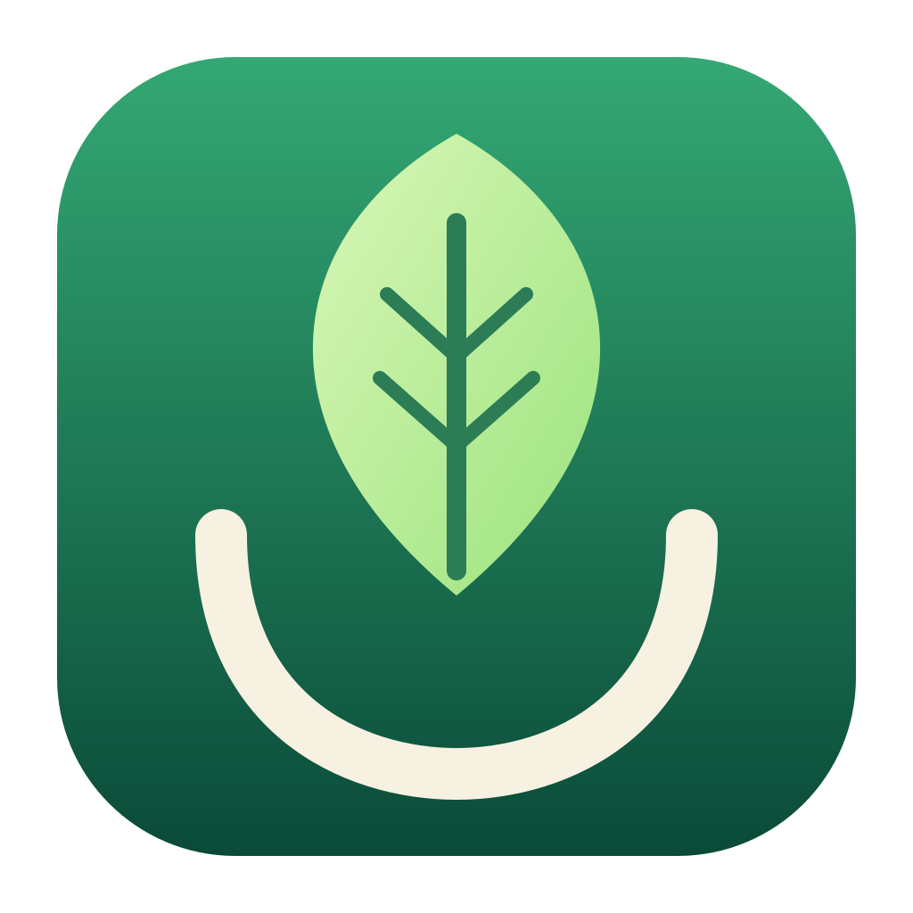

<p align="center">
  
</p>

<h1 align="center">Leafhold Library</h1>

<p align="center">
  <strong>Private AI for your documents. Runs entirely on your computer.</strong>
</p>

<p align="center">
  
  
  
</p>

<p align="center">
  <a href="https://github.com/raj-laddha/leafhold-library-releases/releases/latest"><b>Download</b></a> ·
  <a href="#install">Install</a> ·
  <a href="#getting-started">Getting started</a> ·
  <a href="#faq">FAQ</a> ·
  <a href="#help-and-feedback">Help</a>
</p>

---

## What is Leafhold Library?

Leafhold Library lets you add your own documents and ask questions about them in plain language. The AI model runs **on your computer**, so your documents and chats are never sent to an AI service, and there is no account to create.

- **Private by design.** Your documents, chats and settings stay on your computer. No accounts, no advertising, no tracking of what you do in the app.
- **Answers you can check.** When an answer uses your documents, the file names are shown under **Sources**.
- **Your usual files.** PDF, Word (`.docx`), Markdown (`.md`), plain text (`.txt`) and web pages (`.html`), up to 10 MB each.
- **Workspaces.** One workspace per topic, each with its own documents and chats.
- **Your choice of AI model.** Pick one from the list in the app. Each model shows whether it should fit in your computer's memory right now, and you can switch any time.
- **Long chats stay on track.** Long conversations are summarised automatically, so the AI keeps the main points.
- **Works offline.** After the first set-up, models you have downloaded keep working without the internet.

> [!NOTE]
> **This is an early beta.** It may have bugs, so keep your own backups of anything that matters. AI answers can be wrong: check anything important against your documents.

## Download

Open the **[latest release](https://github.com/raj-laddha/leafhold-library-releases/releases/latest)** and download the file for your computer:

| Your computer | File | Needs |
| --- | --- | --- |
| **Mac** | `Leafhold-Library-<version>-mac-arm64.dmg` | Apple silicon (M1 or newer), macOS 15 or newer |
| **Windows** | `Leafhold-Library-<version>-win-x64.exe` | 64-bit Windows, a processor from about 2013 or newer |
| **Ubuntu** (22.04 or 24.04) | `Leafhold-Library-<version>-linux-amd64.deb` | 64-bit, a processor from about 2013 or newer |
| **Other Linux** | `Leafhold-Library-<version>-linux-x86_64.AppImage` | 64-bit, a processor from about 2013 or newer |

Intel Macs are not supported.

## Install

> [!IMPORTANT]
> The beta is **not signed with a paid developer certificate**, so your computer will warn you the first time you open it. This is expected, and the steps below show what to click. Only download Leafhold Library from this page, and [check your download](#check-your-download) if you want to be sure.

<details>
<summary><b>Mac</b></summary>

1. Open the `.dmg` and drag **Leafhold Library** into **Applications**.
2. Open it from Applications. macOS says it cannot check the app: choose **Done**.
3. Open **System Settings → Privacy & Security**, scroll down to **Security**, click **Open Anyway** next to Leafhold Library, and enter your password.

You only need to do this once.

</details>

<details>
<summary><b>Windows</b></summary>

1. Run the `.exe`.
2. If you see **Windows protected your PC**, click **More info**, then **Run anyway**.

</details>

<details>
<summary><b>Ubuntu (.deb)</b></summary>

1. Open a terminal in the folder with the download and run:

   ```bash
   sudo apt install ./Leafhold-Library-<version>-linux-amd64.deb
   ```

2. Open **Leafhold Library** from your applications menu.

</details>

<details>
<summary><b>Other Linux (.AppImage)</b></summary>

1. Make the file runnable, then start it:

   ```bash
   chmod +x Leafhold-Library-<version>-linux-x86_64.AppImage
   ./Leafhold-Library-<version>-linux-x86_64.AppImage
   ```

2. If it says it needs **FUSE**, install it, or start it without FUSE:

   ```bash
   sudo apt install libfuse2          # Ubuntu 22.04
   sudo apt install libfuse2t64       # Ubuntu 24.04
   ./Leafhold-Library-<version>-linux-x86_64.AppImage --appimage-extract-and-run
   ```

> [!TIP]
> On Ubuntu the `.deb` is the easier choice: it needs no extra steps.

</details>

## Getting started

1. **Create a workspace** on the home screen. A workspace is a folder for one topic, with its own documents and chats.
2. **Add documents** with the **+** next to *Documents*. Wait until each one shows **Ready**.
3. **Pick an AI model.** Open **Settings → Models**, download one and load it. The first download takes a while (a few GB). You can switch models later from the box under the message field.
4. **Ask a question** in the chat. Answers that use your documents list the files under **Sources**.

> [!TIP]
> Not sure which model to pick? Start with the smallest. Bigger models answer better, but they need more memory and are slower. The memory icon at the top right shows how much your computer is using.

> [!NOTE]
> The first time you use the app it also downloads a small model it uses to find the right parts of your documents. After that it works offline.

## Check your download

Every release has a `SHA256SUMS.txt` file with the fingerprint of each installer. Compare it with your file:

| System | Command |
| --- | --- |
| Mac | `shasum -a 256 <file>` |
| Linux | `sha256sum <file>` |
| Windows (PowerShell) | `Get-FileHash <file>` |

If the fingerprint is different from the one listed, do not open the file: download it again.

## Updates, uninstalling and your data

- **Updating:** download the newer version and install it the same way as before. Your data is kept apart from the app, so your workspaces stay.
- **Uninstalling does not delete your data.** To remove it first, open **Settings → Data → Delete all my data**.
- **Uninstalling the app:** on a Mac, drag it to the Bin. On Windows, use **Settings → Apps**. On Ubuntu, run `sudo apt remove leafhold-library`. For the AppImage, delete the file.

## FAQ

<details>
<summary><b>Is anything sent over the internet?</b></summary>

Only a few things, and never your documents or chats:

- The list of available AI models, from GitHub.
- The AI models you choose to download, and the small document-reading model, from Hugging Face.
- Once a day, one small anonymous message to count how many computers use the app: a random install number, the app name and version, and your operating system and chip type. You can see the exact message and turn it off in **Settings → Privacy**.

There are no accounts, no advertising, and no automatic crash reports. The full notice is in the app under **Help**.

</details>

<details>
<summary><b>Why are replies slow on Windows or Linux?</b></summary>

On a Mac with Apple silicon the app uses the graphics chip. In this beta, Windows and Linux use the processor, so replies are slower. Faster support for PC graphics cards is planned. A smaller model is faster.

</details>

<details>
<summary><b>My scanned PDF gives no answers.</b></summary>

A scanned PDF is a picture of pages, so it usually has no text the app can read. Use a PDF that has selectable text.

</details>

<details>
<summary><b>Which files can I add?</b></summary>

PDF, Word (`.docx`), Markdown (`.md`), plain text (`.txt`) and web pages (`.html`). Each file can be up to 10 MB.

</details>

<details>
<summary><b>The AppImage will not start.</b></summary>

Most likely the FUSE library is missing. See the steps under [Other Linux](#install), or use the `.deb` on Ubuntu.

</details>

## Help and feedback

Email **[leafhold.app@gmail.com](mailto:leafhold.app@gmail.com)**. In the app, **Report a problem** (under **Help**) prepares a short technical summary that you can paste into the email. Tell us what you did, what you expected, and what happened.

To report a security problem, see [SECURITY.md](SECURITY.md).

---

<p align="center">
  <sub>The Terms of Use are shown in the app the first time you open it.</sub>
</p>
